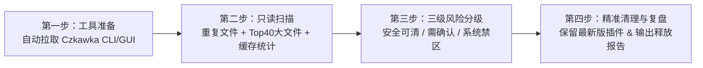

# 🧹 Windows C-Drive Cleaner Skill (`windows-c-drive-cleaner`)

[](https://www.microsoft.com/windows)
[](https://github.com/qarmin/czkawka)
[](#)
[](./LICENSE)

一个专为 **AI 编程助手（Antigravity / Claude Code / Cursor）** 打造的 **Windows C 盘深度诊断与安全清理 Skill**。

它结合了 GitHub 35k+ Star 的 Rust 极速磁盘扫描引擎 **[qarmin/czkawka](https://github.com/qarmin/czkawka)** 与定制化 **PowerShell 安全清理脚本**，通过标准化的 **“四步安全清理法”**，在不触碰任何系统关键文件与软件共享运行库的前提下，精准释放 10GB ~ 30GB+ 的 C 盘空间。

---

## ✨ 为什么需要这个 Skill？

传统的 C 盘清理方式通常存在两大痛点：
1. **盲目用重复文件工具全盘删除**：Windows 系统目录（`WinSxS`、`Windows Defender`）和不同软件目录（`Program Files`）下存在大量同名、同哈希的 `.dll` / `icudtl.dat` / `msedge.dll` 运行库文件。如果直接勾选删除，不仅会遇到权限报错，还会导致软件崩溃甚至系统损坏。
2. **找不到真正的“隐形空间刺客”**：开发者的 C 盘往往被 **VS Code / Cursor 的 C/C++ 符号缓存 (`.BROWSE.VC.DB`)**、**各软件遗留的自动更新包 (`*-updater`)**、**WPS / 微信 / QQ 的历史旧版本插件池** 悄悄塞满，普通清理软件根本扫不到这些目录。

**`windows-c-drive-cleaner`** 将整个排查与清理过程标准化为 AI 可自动执行的 **四步安全工作流**。

---

## 🚀 核心工作流（四步安全清理法）



### 第一步：自动检查与下载 Czkawka 引擎
* 自动检测本地是否存在 `czkawka_cli.exe`。
* 若未安装，脚本会自动通过 GitHub Releases API 拉取 **[qarmin/czkawka](https://github.com/qarmin/czkawka/releases/latest)** 最新版并解压（同时提供 CLI 引擎 `czkawka_cli.exe`、新一代原生 GUI `krokiet.exe` 与经典 GUI `czkawka_gui.exe`）。

### 第二步：全盘只读深度扫描 (`scripts/scan_c_drive.ps1`)
* **重复文件扫描 (`dup`)**：基于 `BLAKE3` 哈希极速扫描 C 盘 `>= 1MB` 的重复文件（自动排除 `C:\Windows`）。
* **巨型单文件扫描 (`big`)**：扫描 C 盘最大的前 40 个单文件，揪出被遗忘的 `.msi` / `.zip` / `.exe` 安装包与休眠文件。
* **专项缓存目录体检**：自动统计 20+ 类高频膨胀目录（`vscode-cpptools`、WPS `addons\pool`、微信 `XPlugin`、QQ `libcef`、豆包 `LarkShell`、`*-updater`、浏览器与 WebView2 缓存等）。

### 第三步：三级风险分类与人工确认（Dry-Run First）
AI 会将扫描出的空间大户按以下三级安全准则分类汇报，**经你确认后才执行删除**：

| 风险等级 | 涵盖范围 | 处理策略 |
| :--- | :--- | :--- |
| 🟢 **第一梯队（极安全）** | • VS Code / Cursor C/C++ 符号缓存 (`.BROWSE.VC.DB`)<br/>• 软件自动更新残留 (`*-updater`、`update\patch`、`QQ\packages`)<br/>• WPS / 微信 / QQ / 编辑器扩展的**历史旧版本目录**<br/>• 各应用内置 WebView2 `component_crx_cache`、浏览器缓存、`Temp`、`CrashDumps` | **强烈推荐清理**：100% 可再生缓存或已废弃旧版本，删除后不影响任何软件运行。 |
| 🟡 **第二梯队（需确认）** | • 旧版微信 3.x / 旧版 QQ 9.x 遗留组件（当已升级至 `xwechat` / `QQNT` 时）<br/>• 豆包 / 飞书本地沙盒环境缓存 (`LarkShell\aha`)<br/>• Windows 休眠文件 (`C:\hiberfil.sys`) | **按需清理**：向用户说明用途，由用户决定是否清理或缩减。 |
| 🔴 **第三梯队（系统禁区）** | • `C:\Windows`（含 `WinSxS`、`System32`、`Installer`）<br/>• `C:\ProgramData\Microsoft\Windows Defender` 引擎库<br/>• `C:\Program Files` 下不同软件各自携带的 `.dll` / `icudtl.dat` | **严禁删除**：属于系统保护或软件运行必需的共享库，强制白名单跳过。 |

### 第四步：智能去重清理与战果复盘 (`scripts/clean_safe_targets.ps1`)
* **多版本目录智能保留**：针对 WPS 插件池 (`addons\pool\win-i386`)、微信插件 (`XPlugin\Plugins`)、QQ 内核 (`libcef`) 以及 `.vscode/extensions`、`.cursor/extensions`，脚本会自动按版本/修改时间排序，**严格保留最新的一份**，仅精准清除历史旧版本。
* **UAC 提权指令生成**：针对 `C:\ProgramData` 下受系统管理员权限保护的驱动/软件更新包，自动生成一行管理员 PowerShell 清理命令。
* **空间前后对比报告**：输出清理前后的 C 盘可用空间对比与各分项释放明细。

---

## 📂 项目目录结构

```text
windows-c-drive-cleaner/
├── README.md                        # 项目说明文档
├── SKILL.md                         # AI Agent 核心工作流指令与安全边界规范
├── LICENSE                          # MIT 开源许可证
└── scripts/
    ├── scan_c_drive.ps1             # 步骤 1 & 2：自动下载 Czkawka + 全盘只读诊断脚本
    └── clean_safe_targets.ps1       # 步骤 4：第一梯队安全缓存与多版本冗余自动清理脚本
```

---

## 🛠️ 安装与使用方法

### 方式一：作为 AI Agent Skill 使用（推荐）

#### 1. Google Antigravity
将本项目克隆或复制到 Antigravity 的全局 Skill 目录或项目工作区目录：
```powershell
# 全局安装（所有工作区生效）
git clone https://github.com/ChenWang8848/windows-c-drive-cleaner.git "$env:USERPROFILE\.gemini\config\skills\windows-c-drive-cleaner"

# 或者安装在当前项目工作区
git clone https://github.com/ChenWang8848/windows-c-drive-cleaner.git ".\.agents\skills\windows-c-drive-cleaner"
```

#### 2. Claude Code / Cursor
将本项目放置到 `.claude/skills/windows-c-drive-cleaner` 或在 Cursor Rules 中引用 `SKILL.md`。

#### 3. 一键对话触发
安装完成后，直接在对话框对 AI 说：
> 💬 **“帮我扫描并清理一下 C 盘”**  
> 💬 **“运行 windows-c-drive-cleaner 技能分析 C 盘空间”**

---

### 方式二：脱离 AI，直接运行 PowerShell 脚本

你也可以直接在 PowerShell 中独立运行配套脚本：

1. **运行只读扫描与诊断（不会删除任何文件）**：
   ```powershell
   powershell -ExecutionPolicy Bypass -File .\scripts\scan_c_drive.ps1
   ```
2. **执行安全缓存与旧版本冗余清理**：
   ```powershell
   powershell -ExecutionPolicy Bypass -File .\scripts\clean_safe_targets.ps1
   ```

---

## 💡 附：Czkawka GUI 手动清理重复文件避坑指南

如果你使用脚本自动下载的 **`krokiet.exe`**（推荐）或 **`czkawka_gui.exe`** 图形界面手动清理重复文件：
1. **不要直接点“全选 (Select All)”**：否则会把原件和副本一起删光。
2. **正确勾选方法**：点击底部工具栏的 **“选择 (Select)”** 按钮 ➡️ 选择 **“选择除最旧之外的所有项 (Select all except oldest)”** 或 **“选择除最新之外的所有项 (Select all except newest)”**，即可每组自动保留 1 份原件，仅勾选多余副本。
3. **排除系统目录**：务必将 `C:\Windows`、`C:\Program Files`、`C:\Program Files (x86)` 加入排除目录。

---

## 🔗 致谢与高 Star 开源清理工具推荐

* **[qarmin/czkawka](https://github.com/qarmin/czkawka)** (~35k+ ⭐)：本项目核心扫描引擎，Rust 编写的超快跨平台重复文件与大文件清理工具。
* **[Chuyu-Team/Dism-Multi-language](https://github.com/Chuyu-Team/Dism-Multi-language)** (Dism++, ~20.7k+ ⭐)：Windows 系统更新备份 (`WinSxS`) 与底层瘦身神器。
* **[Klocman/Bulk-Crap-Uninstaller](https://github.com/Klocman/Bulk-Crap-Uninstaller)** (BCUninstaller, ~20k+ ⭐)：批量深度卸载软件并清除注册表/AppData 孤立残留。
* **[bleachbit/bleachbit](https://github.com/bleachbit/bleachbit)** (~7.4k+ ⭐)：老牌开源系统与应用隐私清理工具。

---

## 📄 License

本项目基于 [MIT License](./LICENSE) 开源。
